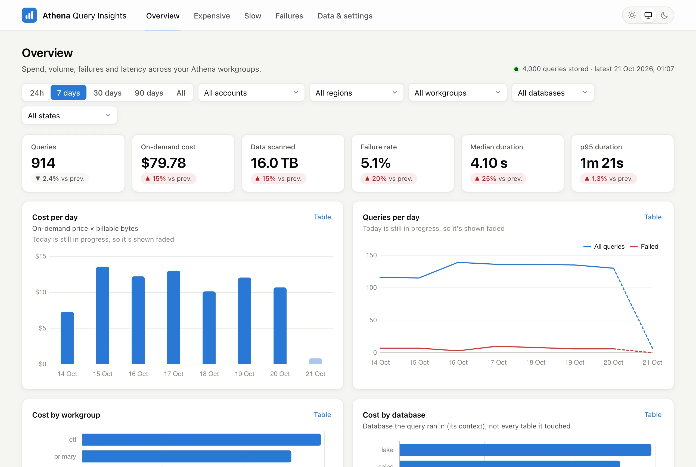
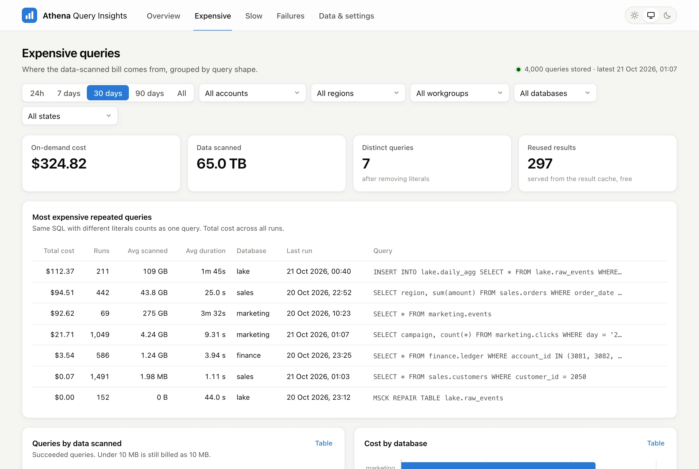
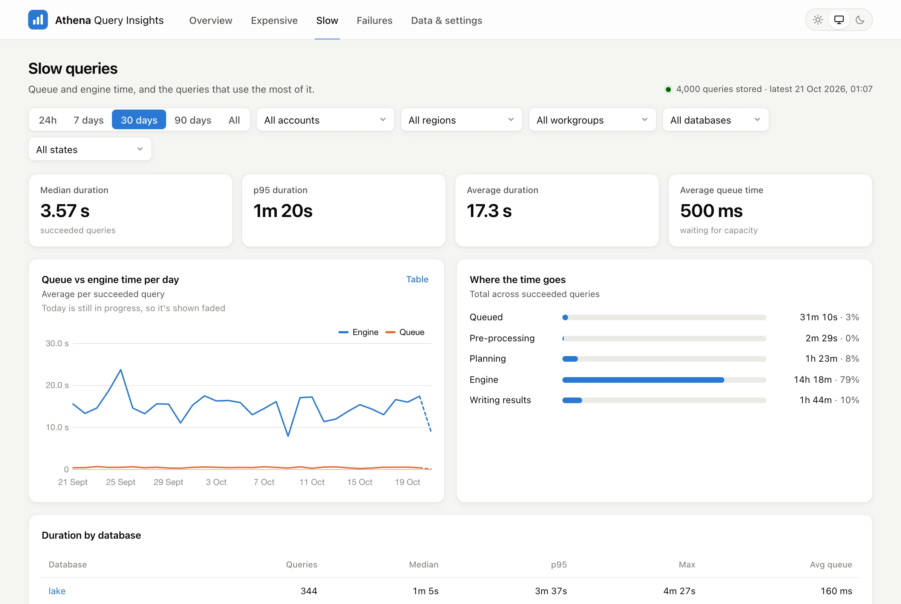
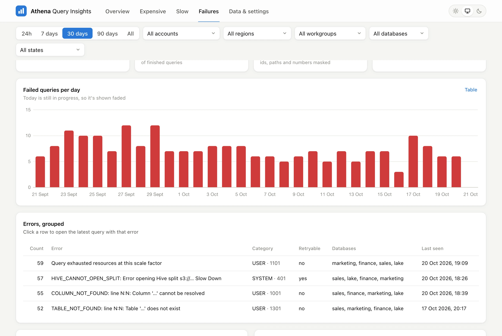
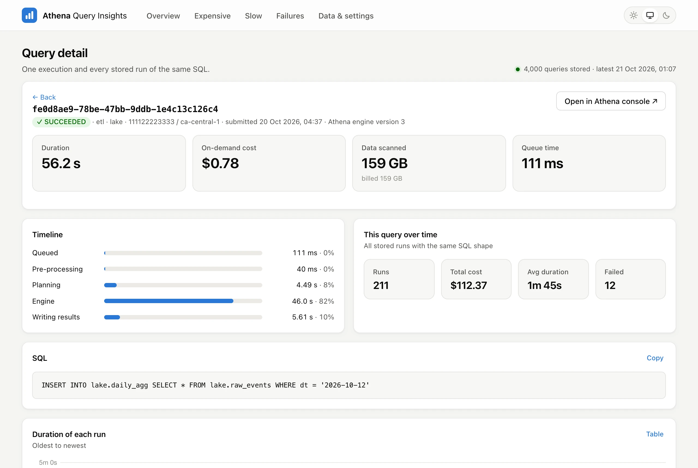
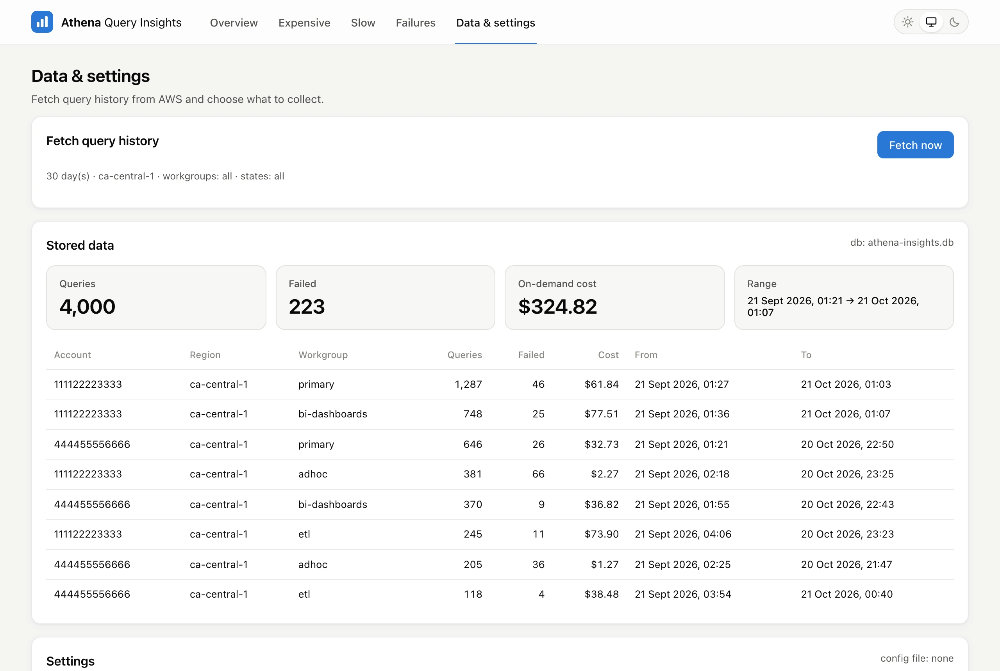
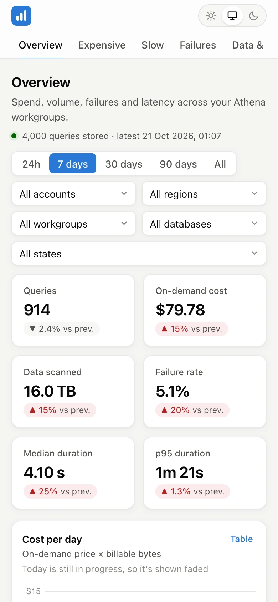
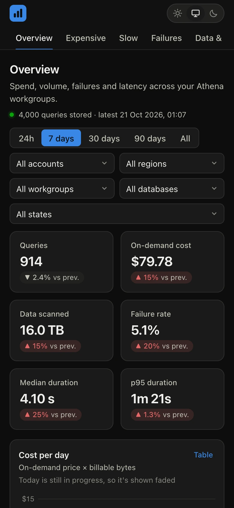
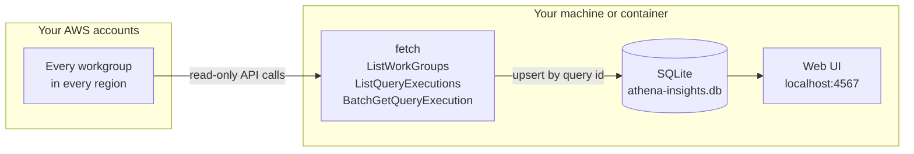

<div align="center">


# Athena Query Insights

**See what every Amazon Athena query costs, how long it took, and why it failed.**<br>
Query history → SQLite → your browser. Nothing to deploy.

[](LICENSE) [](https://nodejs.org) [](#how-it-works) [](#quick-start)

[Quick start](#quick-start) · [Tour](#a-quick-tour) · [How it works](#how-it-works) · [Configuration](#configuration) · [Cost model](#cost-model) · [Roadmap](#roadmap)

<br>

<picture>
  <source media="(prefers-color-scheme: dark)" srcset="docs/screenshots/overview-dark.webp">
  
</picture>

<sub>Screenshots use synthetic demo data. They follow your GitHub light or dark theme, and so does the app.</sub>

</div>

---

## Why

Athena bills by data scanned, but the console shows query history one query at a time, for 45 days, one workgroup at a time. CloudWatch and Cost Explorer stop at the workgroup. So the questions teams actually ask are hard to answer:

- *Which queries are driving the bill, and are they the same query run 1,000 times?*
- *Which databases are slow, and is it the engine or the queue?*
- *What keeps failing, and is it us or Athena?*

**Athena Query Insights** answers them in a few minutes. You don't deploy a pipeline, you don't pay for extra Athena queries to analyse Athena, and you don't need Grafana.

| | Query-level? | Across all workgroups? | Keeps more than 45 days? | Setup |
|---|:---:|:---:|:---:|---|
| Athena console history | ✅ | ❌ | ❌ | none |
| CloudWatch Athena metrics | ❌ | ✅ | ✅ | enable per workgroup |
| Cost Explorer / CUR | ❌ | ✅ | ✅ | billing access |
| CloudTrail → Glue → QuickSight ([AWS blog pattern](https://aws.amazon.com/blogs/big-data/auditing-inspecting-and-visualizing-amazon-athena-usage-and-cost/)) | ✅ | ✅ | ✅ | deploy and maintain a pipeline |
| **Athena Query Insights** | ✅ | ✅ | ✅ | `npm install`, one command |

## Quick start

You need Node.js 22.13 or newer, and AWS credentials that can read Athena query history (see [IAM permissions](#iam-permissions)).

```bash
git clone https://github.com/ranjithkumarmv/aws-athena-query-insights.git
cd aws-athena-query-insights
npm install
node bin/cli.js            # opens the web UI at http://localhost:4567
```

Then open **Data & settings**, pick your AWS profile and regions, and press **Fetch now**. The progress bar fills in as each workgroup is read. Or fetch from the terminal:

```bash
node bin/cli.js fetch --profile prod --region ca-central-1 --days 30
```

> `npx athena-query-insights` and a Docker image are on the way. See the [roadmap](#roadmap).

## A quick tour

<table>
<tr>
<td width="50%" valign="top">

### 💸 Expensive
Repeated queries are grouped by **SQL shape**: the same statement with different literals counts as one query. You see what each one costs across all its runs, plus the most expensive single runs and how many queries fall into each data-scanned band.

</td>
<td width="50%" valign="top">

### 🐢 Slow
Queue time vs. engine time over the period, **where the time goes** (queued, planning, engine, writing results), median and p95 per database, and the queries using the most total time. Those are the ones to optimise first.

</td>
</tr>
<tr>
<td>
<picture>
  <source media="(prefers-color-scheme: dark)" srcset="docs/screenshots/expensive-dark.webp">
  
</picture>
</td>
<td>
<picture>
  <source media="(prefers-color-scheme: dark)" srcset="docs/screenshots/slow-dark.webp">
  
</picture>
</td>
</tr>
<tr>
<td width="50%" valign="top">

### 🚨 Failures
Errors are grouped by pattern, with ids, S3 paths and numbers masked, so dozens of slightly different `HIVE_CANNOT_OPEN_SPLIT …` messages become **one row**. Each row shows the error category, whether it's retryable, the affected databases, and failure rate by database and workgroup.

</td>
<td width="50%" valign="top">

### 🔎 Query detail
Click any row to see the full SQL, the error, a timing breakdown, and **every stored run of the same query** with its duration over time. There's a one-click link to the query in the Athena console.

</td>
</tr>
<tr>
<td>
<picture>
  <source media="(prefers-color-scheme: dark)" srcset="docs/screenshots/failures-dark.webp">
  
</picture>
</td>
<td>
<picture>
  <source media="(prefers-color-scheme: dark)" srcset="docs/screenshots/query-dark.webp">
  
</picture>
</td>
</tr>
<tr>
<td width="50%" valign="top">

### ⚙️ Data & settings
Fetch with a live progress bar, see what's stored per account, region and workgroup, and change settings. Fields pinned by an env var or CLI flag are shown **read-only**, with a badge saying where the value came from.

</td>
<td width="50%" valign="top">

### 📱 Light, dark and phone-sized
Choose **Light**, **Dark** or **System** in the header. Your choice is remembered, and charts redraw in matching colours. The layout works down to phone width.

</td>
</tr>
<tr>
<td>
<picture>
  <source media="(prefers-color-scheme: dark)" srcset="docs/screenshots/data-dark.webp">
  
</picture>
</td>
<td align="center">

&nbsp;

</td>
</tr>
</table>

**Everywhere:** filter by time range, account, region, workgroup, database and state. Filters are kept in the URL, so any view can be bookmarked or shared. Every chart has a **Table** view, and today's still-filling bucket is shown faded so it doesn't look like a sudden drop.

## How it works



1. For each account (your profile's own, or every `--role-arn`) and region, it lists **every workgroup**.
2. For each workgroup it pages through `ListQueryExecutions`, newest first, 50 ids at a time.
3. `BatchGetQueryExecution` is called **only for ids that are new or still running**. Each workgroup stops once a whole page is older than the cutoff.
4. Rows are upserted into one SQLite file. The web UI and its JSON API read from it.

Re-runs are cheap, because finished queries are never fetched twice. Run the fetch on a schedule and history builds up beyond Athena's 45-day limit. **These are listing calls, not queries, so the fetch adds nothing to your Athena bill.**

## Configuration

Every setting can come from any of five places. When the same setting appears in more than one, the later one wins:

**defaults → `athena-insights.config.json` → saved in the UI → environment variables → CLI flags**

A value set by an env var or CLI flag is **locked** in the UI, so a Docker or CI deployment can pin what matters and leave the rest editable. Run `node bin/cli.js config` to print each setting's value and where it came from.

| Setting | CLI | Environment | Default |
|---|---|---|---|
| AWS profile | `--profile` | `ATHENA_INSIGHTS_PROFILE` (falls back to `AWS_PROFILE`) | default chain |
| Regions | `--region` (repeat or comma-separate) | `ATHENA_INSIGHTS_REGIONS` (falls back to `AWS_REGION`) | profile's region |
| Other accounts | `--role-arn` | `ATHENA_INSIGHTS_ROLE_ARNS` | none |
| Workgroups | `--workgroup` | `ATHENA_INSIGHTS_WORKGROUPS` | all |
| Query states | `--state` | `ATHENA_INSIGHTS_STATES` | all |
| Days of history (1–45) | `--days` | `ATHENA_INSIGHTS_DAYS` | 7 |
| Store SQL text | `--no-query-text` | `ATHENA_INSIGHTS_STORE_QUERY_TEXT` | true |
| Price per TB (USD) | `--price-per-tb` | `ATHENA_INSIGHTS_PRICE_PER_TB` | 5 |
| SQLite file | `--db` | `ATHENA_INSIGHTS_DB` | `./athena-insights.db` |
| Bind host / port | `--host` / `--port` | `ATHENA_INSIGHTS_HOST` / `_PORT` | `127.0.0.1` / `4567` |
| Config file | `--config` | `ATHENA_INSIGHTS_CONFIG` | `./athena-insights.config.json` if present |

See [`athena-insights.config.example.json`](athena-insights.config.example.json). AWS credentials always come from the standard AWS chain: env vars, `~/.aws` profiles, SSO, or an EC2/ECS/Lambda role. They are never stored by this tool or typed into the UI.

### Run it on a schedule

`fetch` runs headless and exits, so cron, launchd, a scheduled container or CI can all run it:

```bash
# every hour, keep a rolling history
0 * * * * cd /opt/aws-athena-query-insights && node bin/cli.js fetch --profile prod --days 2
```

## Cost model

`cost = billable bytes ÷ 1 TiB × price per TB`, with billable bytes following Athena's on-demand rules:

- rounded up to the next MB, with a **10 MB minimum per query**
- **failed** queries, **reused results** and DDL that scans nothing are **free**
- **cancelled** queries are charged for what they scanned

Workgroups on capacity reservations are billed per DPU-hour; their queries are shown at the on-demand equivalent. Set `--price-per-tb` for your region's price.

## IAM permissions

Read-only, three actions ([`examples/iam-policy.json`](examples/iam-policy.json)):

```json
{
  "Version": "2012-10-17",
  "Statement": [{
    "Effect": "Allow",
    "Action": ["athena:ListWorkGroups", "athena:ListQueryExecutions", "athena:BatchGetQueryExecution"],
    "Resource": "*"
  }]
}
```

To cover other accounts, create a role with this policy in each one, allow your identity to assume it, and pass the role ARNs with `--role-arn` or in the UI.

## Security & privacy

- **Your data stays local.** Query history goes into one SQLite file you control. Nothing is sent anywhere else.
- The server binds to **`127.0.0.1`** and has **no authentication**. Only bind to another address (`--host 0.0.0.0`) on a network you trust.
- Writes must be same-origin JSON requests, which blocks drive-by CSRF from other websites.
- If query text is sensitive, use **`--no-query-text`** to store only a hash of each query's shape. Grouping and every chart still work.

## Development

```bash
npm test            # node:test with a fake Athena API, so no AWS account needed
```

```
bin/cli.js         command line: serve, fetch, config
src/config.js      layered settings: defaults, file, UI, env, CLI
src/fetch.js       workgroup discovery, paging, incremental fetch, progress events
src/normalize.js   flattening, query-shape hashing, billable bytes
src/db.js          SQLite schema and upserts (built-in node:sqlite)
src/analysis.js    all analysis SQL
src/server.js      HTTP server, JSON API, SSE progress
web/               Vue 3 + Chart.js, served from node_modules, no build step
```

Runtime dependencies are deliberately few: the AWS SDK clients, Vue and Chart.js.

## Roadmap

- [x] Fetch from every workgroup, region and assumed-role account
- [x] Overview, Expensive, Slow, Failures and Query detail pages
- [x] Light / dark / system themes, phone layout
- [ ] Docker image
- [ ] `npx athena-query-insights` (npm publish)
- [ ] `--demo` mode with synthetic data
- [ ] CI and tagged releases
- [ ] CSV export
- [ ] Per-stage details for a single query (`GetQueryRuntimeStatistics`)

Ideas and pull requests are welcome. Please [open an issue](https://github.com/ranjithkumarmv/aws-athena-query-insights/issues).

## License

[MIT](LICENSE) © ranjithkumarmv
